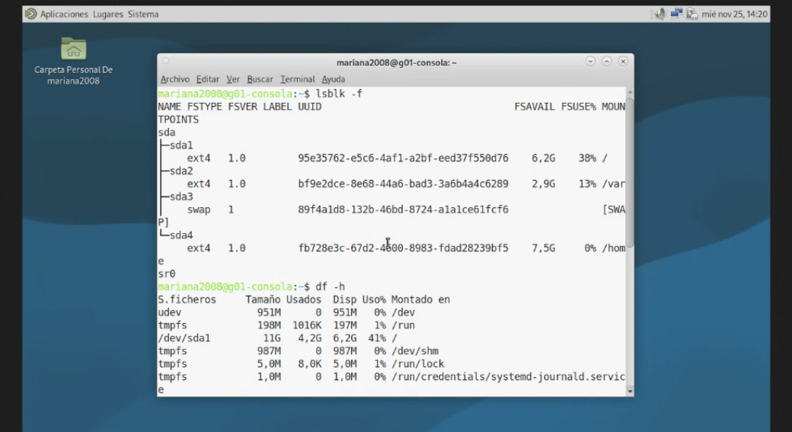
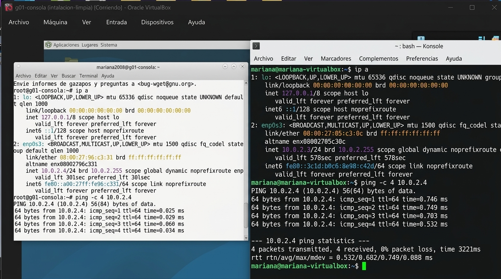
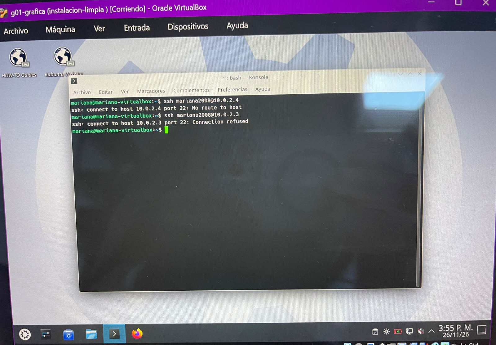
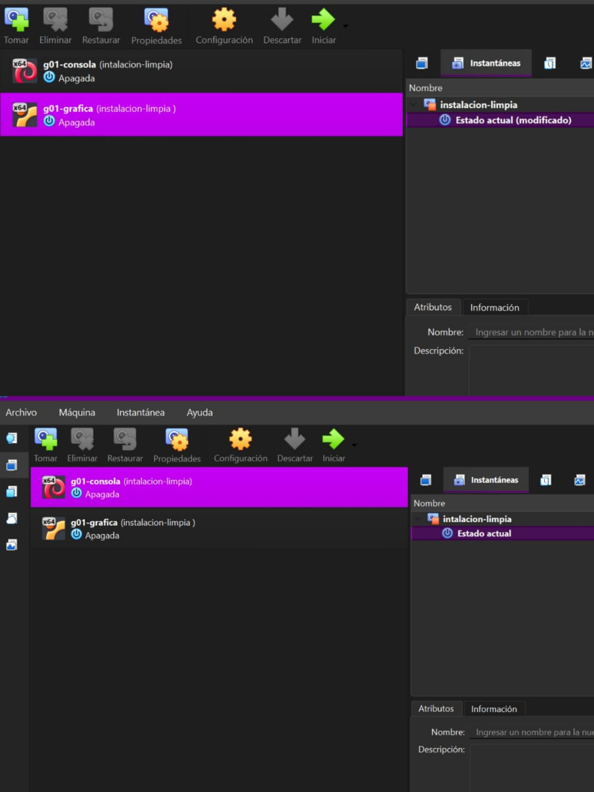

# Sprint 1: Montaje, Particionado y Red

[⬅ Volver a la portada](README.md)

## 1. Descripción General
En este primer sprint se realizó la instalación, el particionado manual, la configuración de red con acceso SSH y la toma de instantáneas (*snapshots*) de las dos máquinas virtuales del Grupo 01:

- **Kubuntu (`g01-grafica`):** Máquina cliente con entorno de escritorio gráfico.
- **Debian 13 Trixie (`g01-consola`):** Servidor configurado en modo consola (`multi-user.target`).

### Esquema de Particionado Manual en Debian (`g01-consola` - `/dev/sda` 26.8 GB)
| Partición | Punto de montaje | Sistema de archivos | Tamaño | Función |
| :--- | :--- | :--- | :--- | :--- |
| `/dev/sda1` | `/` | `ext4` | `12.0 GB` | Sistema base y binarios principales |
| `/dev/sda2` | `/var` | `ext4` | `4.0 GB` | Logs del sistema, caché y servicios |
| `/dev/sda3` | `swap` | `intercambio` | `2.0 GB` | Memoria virtual de intercambio |
| `/dev/sda4` | `/home` | `ext4` | `8.8 GB` | Directorios personales de usuarios |

---

## 2. Comandos Utilizados
| Comando | Para qué sirve |
| :--- | :--- |
| `lsblk -f` | Listar los discos, particiones, puntos de montaje y sistemas de archivos |
| `df -h` | Verificar el espacio total, usado y disponible en cada partición |
| `ip a` | Consultar las interfaces de red y las direcciones IP asignadas |
| `ping -c 4 <IP>` | Comprobar la conectividad de red entre `g01-grafica` y `g01-consola` |
| `ssh usuario@<IP>` | Iniciar sesión remota desde Kubuntu hacia el servidor Debian por SSH |
| `sudo systemctl set-default multi-user.target` | Configurar el arranque de Debian exclusivamente en modo consola |

---

## 3. Evidencias Gráficas

### 3.1. Particionado manual en Kubuntu (`g01-grafica`)

### 3.2. Particionado manual y espacio en disco en Debian (`g01-consola`)

### 3.3. Configuración de red e IP en ambas máquinas virtuales

### 3.4. Acceso remoto por SSH desde `g01-grafica` hacia `g01-consola`

### 3.5. Instantáneas (*snapshots*) creadas en VirtualBox

---

## 4. Video de Sustentación

<iframe width="560" height="315" src="https://youtu.be/s6TvjGk23co" title="Sustentación Sprint 1 - Grupo 01" frameborder="0" allowfullscreen></iframe>
