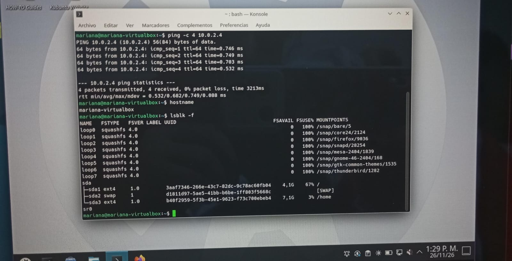

# Sprint 1: Instalación de Máquinas Virtuales y Red

[⬅ Volver a la portada](README.md)

## 1. Descripción General
En este sprint se realizó la instalación y configuración inicial de las dos máquinas virtuales del Grupo 01:
* **Kubuntu (`g01-grafica`):** Entorno de escritorio.
* **Debian (`g01-consola`):** Servidor en modo consola.

---

## 2. Comandos Utilizados
| Comando | Para qué sirve |
| :--- | :--- |
| `lsblk` | Verificar discos y particiones configuradas |
| `df -h` | Revisar el espacio disponible en cada partición |
| `ip a` | Consultar las interfaces y direcciones IP de red |
| `ping -c 4 <IP>` | Comprobar conectividad entre ambas máquinas virtuales |

---

## 3. Evidencias Gráficas
*(Guarda tus capturas dentro de la carpeta `img/` con estos mismos nombres)*

### Particionado y sistema en Kubuntu (`g01-grafica`)

### Red e IP en Debian (`g01-consola`)

---

## 4. Video de Sustentación
*(Reemplaza `ID_DEL_VIDEO` por el código de tu video en YouTube)*

<iframe width="560" height="315" src="https://www.youtube.com/embed/ID_DEL_VIDEO" title="Sustentación Sprint 1" frameborder="0" allowfullscreen></iframe>
